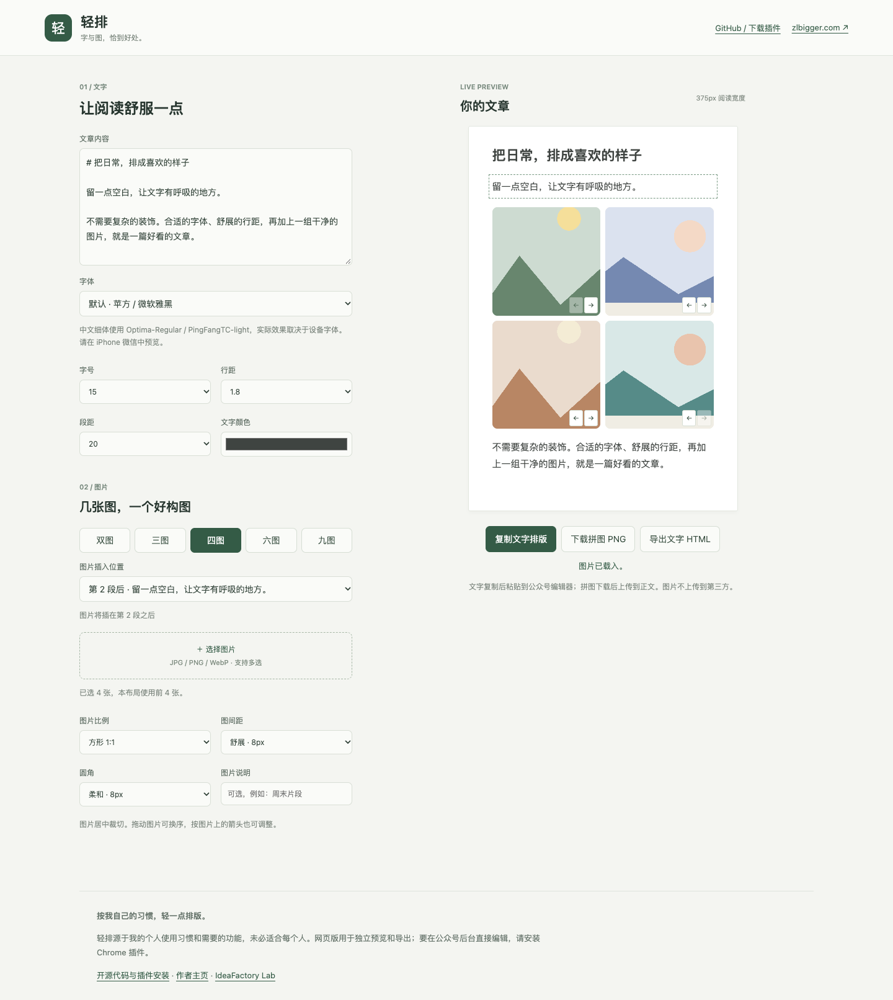
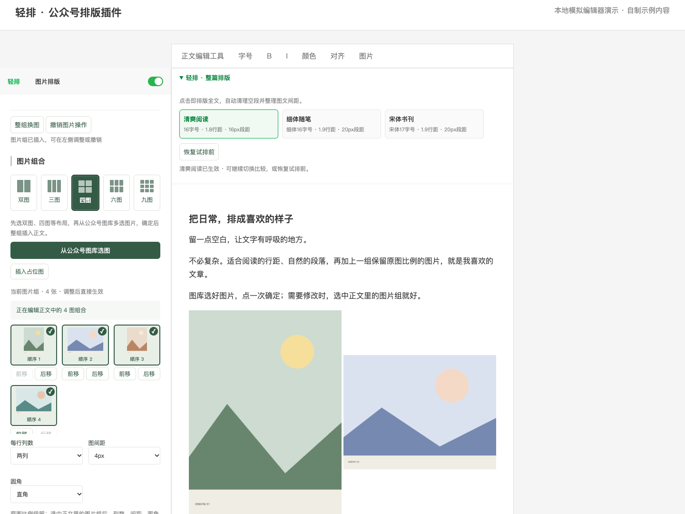
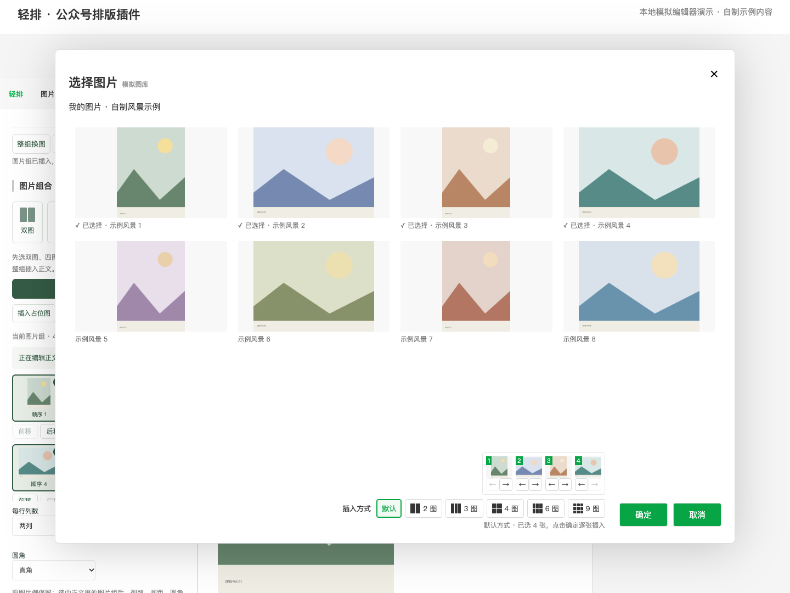

# 轻排 · Qingpai

**字与图，恰到好处。** 一个按个人使用习惯做的公众号排版小工具。

[在线体验](https://lab.ideafactorys.com/qingpai/) · [下载 Chrome 插件](https://github.com/zlbigger/qingpai/releases/latest) · [个人主页 zlbigger.com](https://zlbigger.com/) · [MIT License](LICENSE)

> 轻排首先是给我自己用的。我只想把常用的文字排版、图库选图和多图拼排做得顺手，不想再面对一套复杂的编辑器。
>
> 因此，这里的功能和取舍来自我的个人使用习惯，**未必适合每个人的需求**。如果它恰好适合你，欢迎使用、修改或提出建议；它不追求覆盖所有公众号编辑场景。



## 它能做什么

轻排有两种使用方式，功能并不完全相同：

| | Chrome 插件 | 网页工作台 |
| --- | --- | --- |
| 使用位置 | 微信公众号后台的图文编辑页 | 独立网页，无需安装 |
| 文字 | 三种整篇风格，整理行距、段距、空段与图文留白 | 粘贴文字，实时预览，复制富文本或导出 HTML |
| 图片 | 在公众号原生图库选图，按布局插入独立图片，保留各自比例 | 选择本地图片，调整比例和排序，导出一张拼图 PNG（居中裁切） |
| 原生编辑器 | 基础文字操作继续用公众号自己的工具栏 | 适合预览、试排和独立导出 |

### 插件：在公众号后台直接排版

- **整篇排版默认展开**：清爽阅读、细体随笔、宋体书刊，点击即生效；连续比较风格后可恢复试排前。
- **不重复造编辑器**：字号、颜色、加粗、对齐等沿用公众号原生工具栏。
- **图库里完成拼排**：支持双图、三图、四图、六图、九图；“默认”按公众号原来的方式逐张插入，不会因为多选图片自动拼图。
- **保留每张图片原始比例**：2 图为一行两列，3 图为一行三列，4 图为两行两列，6 图为两行三列，9 图为三行三列。
- **图片组后续修改**：点击正文图片组，左侧可排序、调整列数、间距和圆角，也可从图库整组换图，保留原布局。
- **少一点打断**：记录插入位置，避免主动滚动到页面其他位置；图片操作可撤销，若正文已有后续修改会拒绝覆盖新内容。





截图为**本地模拟编辑器中的功能演示**，使用自制示例文字和图片，不是微信官方界面截图。真实公众号后台的细节会随平台更新变化。

## 安装 Chrome 插件

1. 在 [Releases](https://github.com/zlbigger/qingpai/releases/latest) 下载 `qingpai-extension-版本号.zip`，解压到一个固定目录。
2. Chrome 打开 `chrome://extensions/`，开启右上角“开发者模式”。
3. 点击“加载已解压的扩展程序”，选择解压后**包含 manifest.json 的目录**。
4. 打开或刷新微信公众号图文编辑页。整篇排版入口在原生工具栏下方；图片面板在编辑区左侧。

从源码安装：下载仓库后，第三步选择仓库内的 `extension/` 文件夹。不是把整个仓库作为扩展加载。

更新时覆盖原安装目录，在扩展管理页点击重新加载，然后刷新公众号编辑页。 v0.18.5 修复了微信发布时清理 `calc()` 列宽导致图片大小不一致的问题。旧草稿中的图片组可选中后调整一次图间距，再改回所需值，即可重写为新版布局；已经发布的文章不会自动改变。当前以开发者模式安装提供，不是 Chrome 应用商店版本。

### 一个典型流程

1. 在公众号原生编辑器里写文章，点击一种整篇风格。
2. 点击正文里需要插图的位置，打开公众号图库。
3. 逐张插入就保留“默认”；需要拼排则选择 2 / 3 / 4 / 6 / 9 图，选齐对应数量后点击“确定”。
4. 后续点击正文中的图片组，在左侧修改或整组换图。
5. 使用公众号自己的保存与手机预览，确认最终效果。

插件不会替你发表文章。

## 网页版

直接使用：**https://lab.ideafactorys.com/qingpai/**

粘贴文章后即可预览，选择本地图片生成拼图。左侧是可显示图片块的文章编辑区：选好布局并定位光标后点击“在光标处插入占位图片组”，先显示空白图片位置；点击任意位置后可直接粘贴图片，不必先打开本地文件选择器。也可独立选择本地图片，左右同步预览；光标位于段中时会保留并分开前后文字。目前工作台支持一组图片组合，可移动其位置。文字复制/HTML 导出仍只包含文字，拼图 PNG 单独下载。文字可复制为富文本或导出 HTML，图片拼图下载为 PNG，再自行上传到公众号。网页不是公众号后台的镜像，也不会读取你的微信图库。

本地运行只需要 Python 3：

```bash
python3 -m http.server 8765 --bind 127.0.0.1
```

打开 `http://127.0.0.1:8765/`。复制富文本需要安全上下文（HTTPS 或 localhost）及浏览器授权；失败时可以导出 HTML。

## 文字局部排版与图片后继续输入

- 选中文字后点击“清爽阅读 / 细体随笔 / 宋体书刊”，只排版选区涉及的完整段落；没有文字选区时整理全文。界面自动提示当前范围。
- 字体选择位于微信工具栏下方的“轻排 · 文字排版”中，可单独修改选中文字；目前没有改写微信原生字体下拉菜单。
- 选中图片组后点击“下方继续写”，会在图片组外创建或复用空段落并定位光标。在图片组内按 Enter 也可跳出；Shift+Enter 保持原编辑器行为。
- 自 v0.19.2 起，文字排版仅调整现有节点样式，不使用浏览器 HTML 插入命令或微信第三方 HTML 插入接口。
- v0.19.0 已在本地 Chrome 模拟编辑器验证局部风格、字体、周围段落保留以及图片后输入；仍需在实际公众号编辑页验证平台兼容性。

## 等宽瀑布流图片组

v0.19.1 的双图、三图、四图、六图、九图采用等宽列：图片按原始宽高比缩放，每列内部保持固定上下间距，横竖图混排不再按行居中。图片按所选顺序从左到右分配到各列，批量换图、调整列数和顺序保持一致。

列宽使用普通百分比，图片同时设置最小、最大宽度，以应对微信发布时删除 `calc()` 声明或延迟加载改写图片像素宽度。已在本地浏览器模拟这些行为，仍需以实际微信预览和发布显示为准。

旧草稿中的图片组：更新插件并刷新编辑页后，点选图片组，调整一次间距再改回，即可迁移到等宽瀑布流。已经发布的文章不会自动更新。

## v0.19.2 内容保留修复

修复文字排版通过整篇 HTML 重新插入，可能被编辑器截断、导致图文丢失的高风险路径。文字风格、字体调整与排版撤销现在只更新原有段落及子节点的样式，不调用 HTML 插入接口，不删除或重建正文节点。字体调整作用于选区涉及的完整段落。

排版前检查节点结构、文字和非样式属性，操作后检查节点身份与文字是否保留。若编辑器未保留样式，停止操作并回退可回退的样式修改。当前不自动清理空行空段，也不把纯文本拆成新段落，以保留原始图文结构。

每次修改前在当前页面内存中保留 HTML 备份，可点“下载排版前备份”保存到本地。它不是微信保存记录，也不是永久历史版本：刷新或关闭页面后不可用，无法恢复旧版插件已经丢失的内容。备份引用原图片链接，不包含图片文件。

新增长文回归：101 个文字段落、102 张图片、100 个链接，检查风格切换、字体调整、撤销不调用 HTML 插入，且节点保持不变。真实微信编辑器可能拒绝样式变更；此时显示错误，不回退到整篇重新插入。

## 跟随微信工具栏的文字排版栏

v0.19.3 将文字排版收紧为常用风格、字体和撤销入口。长文滚动时，排版栏贴在微信原生工具栏下方，并跟随其位置和宽度；可通过“轻排 · 文字排版”收起。保留原位置占位，避免固定后正文突然上移。

点击风格保留正文选区，字体控件聚焦期间不覆盖保存的选区。微信原生工具栏保持更高层级，下拉菜单可覆盖排版栏。本次通过本地模拟编辑页检查，实际平台布局变化仍可能需要适配。

## v0.19.4 微信段落识别与更新确认

根据真实公众号编辑页检查，微信正文使用 `.view` 内的 `.ProseMirror`，段落为 `section + span[leaf]`；标题也有一个独立的 `.ProseMirror`。新版排除标题编辑器，优先识别正文，保留并验证 section 段落排版。

排版栏标题直接显示运行版本 v0.19.4，操作结果显示实际调整段落数。若只是微信重建等价节点、内容与样式仍保留，不再因为节点身份变化而回退；文字、媒体或链接变化时仍停止。排版不修改微信的 ProseMirror 分隔图片。

**下载新版不等于已更新 Chrome 中加载的插件。** 若排版栏仍显示旧版本，请在扩展管理页确认加载的是新版解压目录，重新加载插件，再刷新已保存草稿的编辑页。不要在未保存的草稿上直接刷新。

本次真实页面只做了读取诊断，发现当前仍运行 v0.19.1 并显示“没有找到可排版的文字”。新版的段落识别、节点重建与内容保留已通过本地回归；未对用户当前草稿应用新版样式。

## 数据、字体与兼容性

- 插件只匹配 `https://mp.weixin.qq.com/*`，声明 `activeTab` 权限；没有账号登录、第三方图片上传服务或分析统计 SDK。
- 插件通过当前页面的公众号编辑接口及图库组件工作，**依赖微信当前实现**，平台更新可能导致失效。轻排不是微信官方产品，也不依赖其他公众号排版插件。
- 网页版的文字和图片在浏览器内处理；偏好保存在本地。静态托管站点仍可能有常规访问日志。
- 字体使用设备已安装的系统字体；项目不附带字体文件。中文细体在不同系统上可能回退，请以目标设备中的微信预览为准。
- 不自动改写文章、不猜测标题、不自动替换标点；空段整理与视觉排版保留现有内容。
- 当前主要针对桌面 Chrome。尚未全面验证所有公众号版本、其他插件组合、保存后及手机端的每种渲染情况。建议先在测试草稿中试用。

## 开发与验证

运行需要 Node.js 22+、Python 3；网页和插件本身均无运行时 npm 依赖。

```bash
npm ci
npm test
npm run package
```

安装包输出到 `dist/`。测试覆盖整篇排版、内容保留、撤销保护、图库排序、默认逐张插入、拼排插入和整组换图。DOM 自动测试不能替代真实公众号及手机预览验证。

```text
index.html / app.js / style.css   网页工作台
content.js                       插件界面与编辑逻辑
page-bridge.js                   公众号原生接口桥接
background.js / manifest.json    Chrome 扩展入口与配置
extension/                       可直接加载的安装目录
qa/                              自动测试和本地兼容性页面
scripts/                         校验与打包脚本
docs/                            自制示例素材与截图
```

修改插件源文件后，同步对应文件到 `extension/`；`npm test` 会检查两份代码一致。

## 反馈与许可

欢迎在 [Issues](https://github.com/zlbigger/qingpai/issues) 描述具体使用场景。反馈问题时请提供浏览器版本、操作步骤和脱敏截图，不要上传账号凭证、微信 token 或未公开文章。

[MIT](LICENSE) 开源。作者：[zlbigger](https://zlbigger.com/)。

## v0.20.0 左右滑图

图库底部可选「等宽拼图 / 左右滑图」，再选图片数量、点击确定；默认逐张插入仍沿用微信原生流程。已有图片组也可在「显示方式」中切换两列、三列或左右滑图，不需要重新选图片。

左右滑图一次显示一张，保留原比例，采用纯内联横向滚动和滑动对齐结构。普通滑图设置 `pointer-events:none` 降低点击进入大图的可能；占位图保留点击替换。**禁止点开并非微信官方能力，仍需在手机微信预览确认；尚未完成新版本的实际发布验证。**

参考了用户提供的公开文章中的横向滚动结构，没有复制其图片或正文。本地自动化覆盖滑图图库确认、切回拼图、2/3/4/6/9 张图片、原比例、占位替换，以及原有排版、撤销、内容保留、排序、批量替换和文末续写。

## v0.20.1 文字生效、整组换图与独立幻灯片

- 文字排版接入微信 ProseMirror 的样式事务，修改段落及内联文字样式属性；保留原文、链接、图片与加粗，不重新插入整篇 HTML。遇到不支持的结构会在提交前停止。文字撤销使用相同的样式事务。
- 修正整组换图总沿用旧图片数量的问题。在图库选择 6 图会按新选择更新整组，不再强制保留旧 3 张。
- 「横向幻灯片」成为独立入口，与两列、三列拼图分开。图库内点击「横向幻灯片 ↔」，选择 2 至 50 张图片后确定；无需再指定 6 图或 9 图。已有图片组也可直接切换。
- 幻灯片使用固定 4:3 展示区域，一次展示一张，整张等比放入（宽高比不同时留白），并显示「当前张数 / 总张数」和滑动提示，避免被长图撑高。采用内联 CSS，无脚本自动播放。

验证包括真实 ProseMirror 库的样式事务、嵌套文字格式、撤销、字体、失败时不提交部分变更，以及整组 3→6 张和幻灯片 6 张插入。Chrome 本地检查 320/375/430/768px 宽度下的固定高度和实际滑动。尚未完成新版在手机微信发布后的验收，不能保证所有客户端的防点开大图行为。需要重新加载扩展并刷新公众号页，确认 v0.20.1。


## v0.20.2 操作回归修复

修正幻灯片点击选组、图库取消后的状态恢复、换图失败后的选项回退，以及选区恰好结束于下一段开头时误改下一段的问题。图片撤销只处理对应图片组；图片下方续写接入原生编辑模型，生成可输入段落。幻灯片隐藏不适用的列数和间距，整组换图隐藏不适用的“默认”选项。

自动测试通过 41 个图片操作场景，并使用真实 ProseMirror 库验证长文样式事务、选区边界、图片续写和撤销。Chrome 中也检查了本地合成测试页的实际点击与输入。**这不等于通过真实公众号发布和手机微信验收。** 详细范围及复现方式见 [回归测试记录](qa/REGRESSION.md)。更新后需重新加载扩展，并在保存草稿后刷新编辑页，确认显示 v0.20.2。
