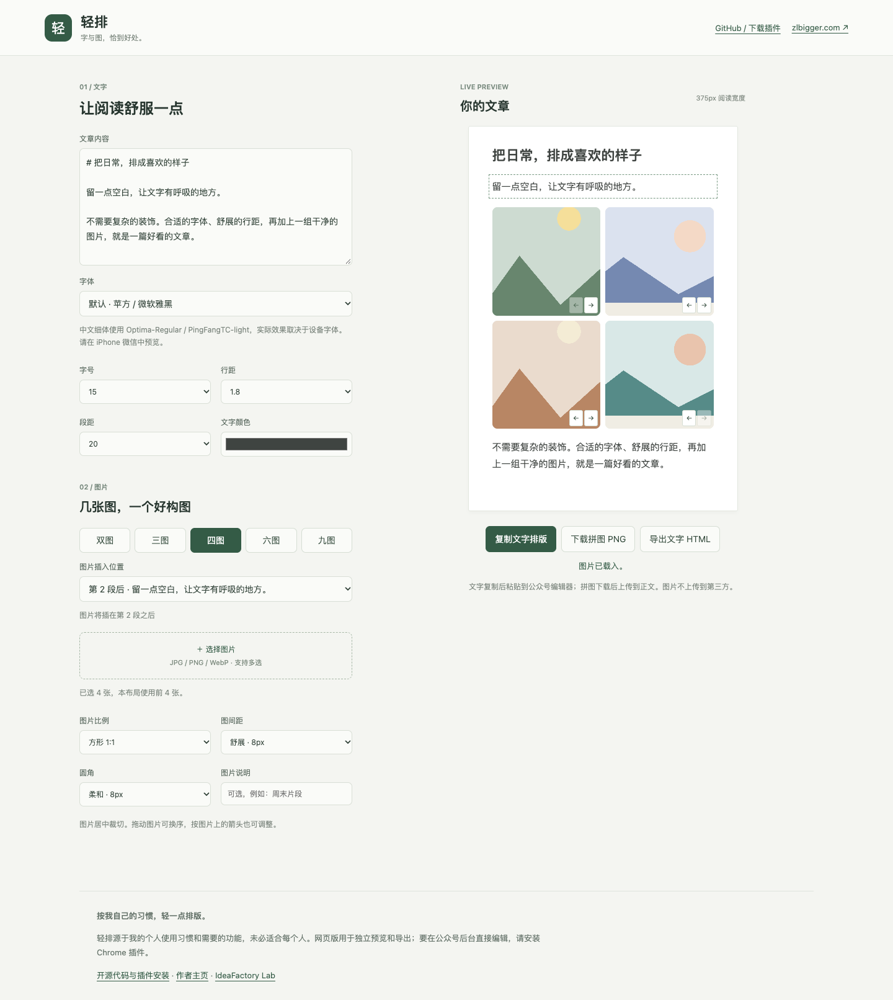
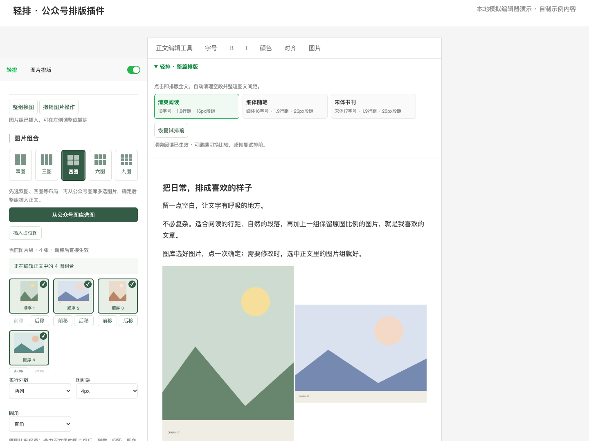
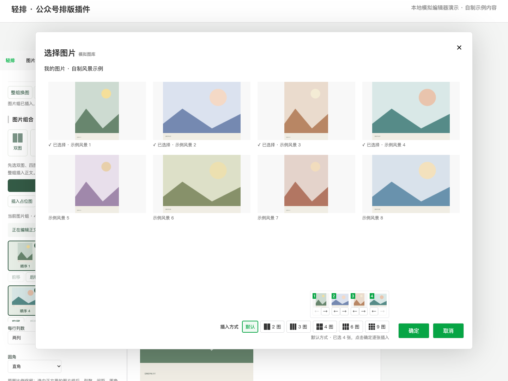

# 轻排 · Qingpai

**字与图，恰到好处。** 一个按个人使用习惯做的公众号排版小工具。

[在线体验](https://lab.ideafactorys.com/qingpai/) · [下载 Chrome 插件](https://github.com/zlbigger/qingpai/releases/latest) · [个人主页 zlbigger.com](https://zlbigger.com/) · [MIT License](LICENSE)

> 轻排首先是给我自己用的。我只想把常用的文字排版、图库选图和多图拼排做得顺手，不想再面对一套复杂的编辑器。
>
> 因此，这里的功能和取舍来自我的个人使用习惯，**未必适合每个人的需求**。如果它恰好适合你，欢迎使用、修改或提出建议；它不追求覆盖所有公众号编辑场景。



## 它能做什么

轻排有两种使用方式，功能并不完全相同：

| | Chrome 插件 | 网页工作台 |
| --- | --- | --- |
| 使用位置 | 微信公众号后台的图文编辑页 | 独立网页，无需安装 |
| 文字 | 三种整篇风格，整理行距、段距、空段与图文留白 | 粘贴文字，实时预览，复制富文本或导出 HTML |
| 图片 | 在公众号原生图库选图，按布局插入独立图片，保留各自比例 | 选择本地图片，调整比例和排序，导出一张拼图 PNG（居中裁切） |
| 原生编辑器 | 基础文字操作继续用公众号自己的工具栏 | 适合预览、试排和独立导出 |

### 插件：在公众号后台直接排版

- **整篇排版默认展开**：清爽阅读、细体随笔、宋体书刊，点击即生效；连续比较风格后可恢复试排前。
- **不重复造编辑器**：字号、颜色、加粗、对齐等沿用公众号原生工具栏。
- **图库里完成拼排**：支持双图、三图、四图、六图、九图；“默认”按公众号原来的方式逐张插入，不会因为多选图片自动拼图。
- **保留每张图片原始比例**：2 图为一行两列，3 图为一行三列，4 图为两行两列，6 图为两行三列，9 图为三行三列。
- **图片组后续修改**：点击正文图片组，左侧可排序、调整列数、间距和圆角，也可从图库整组换图，保留原布局。
- **少一点打断**：记录插入位置，避免主动滚动到页面其他位置；图片操作可撤销，若正文已有后续修改会拒绝覆盖新内容。





截图为**本地模拟编辑器中的功能演示**，使用自制示例文字和图片，不是微信官方界面截图。真实公众号后台的细节会随平台更新变化。

## 安装 Chrome 插件

1. 在 [Releases](https://github.com/zlbigger/qingpai/releases/latest) 下载 `qingpai-extension-版本号.zip`，解压到一个固定目录。
2. Chrome 打开 `chrome://extensions/`，开启右上角“开发者模式”。
3. 点击“加载已解压的扩展程序”，选择解压后**包含 manifest.json 的目录**。
4. 打开或刷新微信公众号图文编辑页。整篇排版入口在原生工具栏下方；图片面板在编辑区左侧。

从源码安装：下载仓库后，第三步选择仓库内的 `extension/` 文件夹。不是把整个仓库作为扩展加载。

更新时覆盖原安装目录，在扩展管理页点击重新加载，然后刷新公众号编辑页。当前以开发者模式安装提供，不是 Chrome 应用商店版本。

### 一个典型流程

1. 在公众号原生编辑器里写文章，点击一种整篇风格。
2. 点击正文里需要插图的位置，打开公众号图库。
3. 逐张插入就保留“默认”；需要拼排则选择 2 / 3 / 4 / 6 / 9 图，选齐对应数量后点击“确定”。
4. 后续点击正文中的图片组，在左侧修改或整组换图。
5. 使用公众号自己的保存与手机预览，确认最终效果。

插件不会替你发表文章。

## 网页版

直接使用：**https://lab.ideafactorys.com/qingpai/**

粘贴文章后即可预览，选择本地图片生成拼图。左侧是可显示图片块的文章编辑区：定位光标后点击“在光标处插入图片组合”，选择图片后在左侧正文中显示，右侧同步预览；光标位于段中时会保留并分开前后文字。目前工作台支持一组图片组合，可移动其位置。文字复制/HTML 导出仍只包含文字，拼图 PNG 单独下载。文字可复制为富文本或导出 HTML，图片拼图下载为 PNG，再自行上传到公众号。网页不是公众号后台的镜像，也不会读取你的微信图库。

本地运行只需要 Python 3：

```bash
python3 -m http.server 8765 --bind 127.0.0.1
```

打开 `http://127.0.0.1:8765/`。复制富文本需要安全上下文（HTTPS 或 localhost）及浏览器授权；失败时可以导出 HTML。

## 数据、字体与兼容性

- 插件只匹配 `https://mp.weixin.qq.com/*`，声明 `activeTab` 权限；没有账号登录、第三方图片上传服务或分析统计 SDK。
- 插件通过当前页面的公众号编辑接口及图库组件工作，**依赖微信当前实现**，平台更新可能导致失效。轻排不是微信官方产品，也不依赖其他公众号排版插件。
- 网页版的文字和图片在浏览器内处理；偏好保存在本地。静态托管站点仍可能有常规访问日志。
- 字体使用设备已安装的系统字体；项目不附带字体文件。中文细体在不同系统上可能回退，请以目标设备中的微信预览为准。
- 不自动改写文章、不猜测标题、不自动替换标点；空段整理与视觉排版保留现有内容。
- 当前主要针对桌面 Chrome。尚未全面验证所有公众号版本、其他插件组合、保存后及手机端的每种渲染情况。建议先在测试草稿中试用。

## 开发与验证

运行需要 Node.js 22+、Python 3；网页和插件本身均无运行时 npm 依赖。

```bash
npm ci
npm test
npm run package
```

安装包输出到 `dist/`。测试覆盖整篇排版、内容保留、撤销保护、图库排序、默认逐张插入、拼排插入和整组换图。DOM 自动测试不能替代真实公众号及手机预览验证。

```text
index.html / app.js / style.css   网页工作台
content.js                       插件界面与编辑逻辑
page-bridge.js                   公众号原生接口桥接
background.js / manifest.json    Chrome 扩展入口与配置
extension/                       可直接加载的安装目录
qa/                              自动测试和本地兼容性页面
scripts/                         校验与打包脚本
docs/                            自制示例素材与截图
```

修改插件源文件后，同步对应文件到 `extension/`；`npm test` 会检查两份代码一致。

## 反馈与许可

欢迎在 [Issues](https://github.com/zlbigger/qingpai/issues) 描述具体使用场景。反馈问题时请提供浏览器版本、操作步骤和脱敏截图，不要上传账号凭证、微信 token 或未公开文章。

[MIT](LICENSE) 开源。作者：[zlbigger](https://zlbigger.com/)。
