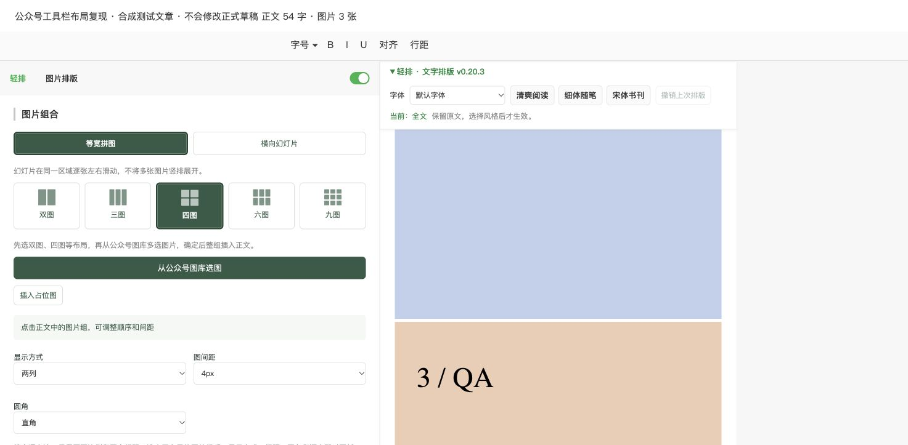

# 回归测试记录

日期：2026-11-03（Asia/Shanghai），版本 v0.20.2。

## 自动化范围

运行 `npm ci`、`npm test`。全部通过后运行 `npm run package`。

- 41 个图片流程场景：2/3/4/6/9 张之间的全部 25 种数量切换、图片顺序、取消、数量不匹配、接口拒绝、重试、选项回退、新组插入、局部撤销、幻灯片数量边界、默认插入、重复确认与后续编辑保护。
- 真实 ProseMirror 模型：文字风格、字体、嵌套标记、选区终点边界、撤销、临时节点选中装饰、图片下方续写、空段落内可写文字节点、重复续写复用空行、不支持的样式目标整笔拒绝。
- 长文：101 段文字、102 张图片、100 个链接；三种风格保留内容、图片及链接。DOM 测试另检查周围节点身份不变。
- 原有测试：图库排序、发布结构的等宽列与间距、左右滑图结构、微信 section/span 段落、标题排除、内容保留、安装目录与源码一致。

## Chrome 实际操作

运行 `npm run qa:browser`，打开 http://127.0.0.1:8766/ 。页面使用真实 ProseMirror 库与模拟微信图库/插入接口，内容为可丢弃的合成文章。

已检查文字风格切换及恢复、点击幻灯片舞台选组、3→6 张整组替换及撤销、图片下方续写与实际键盘输入、后续输入阻止旧撤销覆盖。幻灯片模式下列数和间距控件不再显示。

## 本次发现并修复

- 幻灯片图片禁用指针事件后，舞台点击不能选中图片组。
- 图片撤销依赖整篇 HTML；改为校验后只替换或删除目标组及其未修改的空尾段。
- 续写只更新 DOM 或落入后面的原段落；改为模型事务并明确建立可写节点。
- 选区结束在下一段起点时误改下一段。
- 换图失败/取消后控件残留未生效的模式；错误提示被延迟状态刷新覆盖。
- ProseMirror 临时选中样式导致安全撤销被误拒绝。
- shadow CSS 覆盖 hidden 属性，显示本应隐藏的控件。
- 整组换图出现不适用的默认插入选项。

## 验证边界

模拟接口不能证明微信当前接口、保存过滤和发布客户端完全兼容。本轮未修改用户正式草稿、未发布文章，未完成真实微信手机端验证。等宽图片发布、幻灯片滑动和禁止点开大图仍需在真实公众号测试草稿及手机预览确认。通过这些测试不代表不存在其他 bug。

## v0.20.3 工具栏遮挡修复

用户截图暴露 v0.20.2 布局测试缺口。只读检查当前公众号页发现：原生工具栏滚动后为固定定位，宽度 1473px，而正文容器仅 578px。旧代码复制原生栏的左右边界，导致文字栏铺满视口，被左侧图片面板盖住。

现在文字栏以自身文档流占位容器确定左右边界，只用原生工具栏底边确定顶部；图片区层级低于原生编辑器，文字栏高于正文内容。风格按钮可换行，范围和状态提示单列到下方。

新增 `toolbar-position.test.cjs`，覆盖全屏原生栏、正文偏移、420px 等窄栏、视口边界裁切、自然文档流、正文结束解除固定以及正文不变。完整 `npm test` 通过。

独立浏览器复现：`node qa/toolbar-browser.cjs`，打开 http://127.0.0.1:8767/ 或 http://127.0.0.1:8767/?narrow 。该页面刻意模拟微信的全屏固定原生栏和堆叠上下文，使用合成内容。Chrome 实测 578px 和 420px 正文宽度，按钮全部处于文字栏边界内；展开图片面板不重叠，模拟原生菜单的点击命中检测通过。窄栏应用风格后，备份按钮及较长状态提示没有横向溢出。

当前真实公众号页只做只读诊断，没有刷新或修改用户草稿。新版安装后在真实页面的显示仍需核对；上述截图不是用户正式文章。
